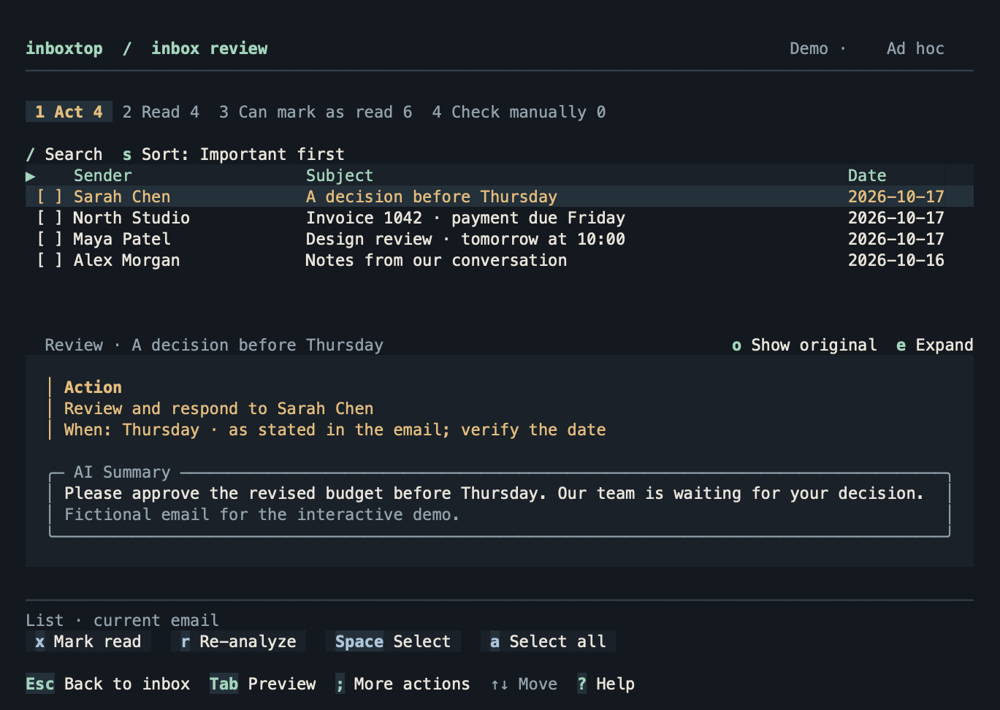

# inboxtop

Review your inbox, catch up on newsletters, and ask questions about your mail—from
the terminal. Keyboard-first, with an optional macOS menu companion.



*Review screen with fictional demo emails.*

**Early preview.** Source installation is available; signed downloadable releases
are not published yet. macOS ARM64 is locally verified. Native CI passes on macOS and Linux,
on both x64/Intel and ARM64; other-platform manual acceptance remains pending.
Chat results can have incomplete coverage.

## What it does

- **Review:** groups analyzed unread mail into Act, Read, Low priority and Check
  manually, with summaries and original messages available side by side.
- **Subscriptions:** browse newsletter issues by sender and generate a combined
  summary from saved analyses.
- **Chat:** ask follow-up questions, inspect cited emails, and search a bounded
  part of your configured inbox when saved evidence is insufficient.
- **Stay in control:** reading never marks mail read. Mailbox changes are separate
  actions; bulk changes show their scope before confirmation.

## Install and try

Use macOS and a modern terminal for the currently verified path. Install Git and
Node.js/npm; Node 26.4+ matches the pinned UI dependency's declared Node requirement.
`npm ci` installs the pinned Bun runtime, so no global Bun installation is needed.

```sh
git clone https://github.com/nazdash/inboxtop.git
cd inboxtop
npm ci
./inboxtop --demo
```

Demo uses fictional mail, no credentials, network requests or background service.
Use arrows to navigate, Enter to open, Tab to change focus, Esc to go back, and
`?` for help. Ctrl+C exits.

See [installation and platform support](docs/INSTALLATION.md) for prerequisites,
local builds, upgrades and troubleshooting. No Homebrew, npm-global or one-line
download installer is published yet.

## Connect your email

```sh
./inboxtop setup
```

1. Enter your IMAP address and app password in the local masked form; explicitly
   test the connection. OAuth is not implemented, so some accounts cannot connect.
2. Choose OpenAI or local Ollama and explicitly test AI with fictional text.
   Cloud tests can incur charges; Ollama requires models you have already installed.
3. Save to the OS credential store. Start a small analysis batch when ready.

Follow [credential setup](docs/SETUP.md). Never put passwords or API keys in issues,
chat, screenshots or command arguments. Normal launches use `./inboxtop`.

## Privacy and limits

Cloud AI receives selected email content. Ollama runs locally with no cloud
fallback. There is no product analytics. Saved mail is encrypted, but its key lives
beside it; access to both permits decryption. This is not a mailbox backup.

Chat searches the configured mailbox, not every folder, attachment or linked page.
Its request and context limits can produce a small sample for a broad question.
Citations and coverage labels help you inspect what the answer used; do not assume
an exhaustive review. Closing the terminal does not stop an existing Live worker.
Use Stop analysis or Ad hoc when you want automatic analysis to stop.

Read [security and privacy](SECURITY.md), [the user guide](docs/USAGE.md), and
[recovery/removal](docs/RECOVERY.md).

## For contributors and coding agents

Start with [AGENTS.md](AGENTS.md), [product principles](PRINCINPLES.md),
[UI principles](UI-PRINCIPLES.md), [architecture](ARCHITECTURE.md), and
[contributing](CONTRIBUTING.md). The [agent setup guide](docs/AGENT-SETUP.md)
documents offline JSON diagnostics and safe credential entry.

To have a coding agent install it, give it this instruction:

> Install https://github.com/nazdash/inboxtop following `docs/AGENT-SETUP.md`.
> Verify it with the offline demo, then show me how to enter credentials locally.
> Do not connect to my mail or start analysis as an installation test.


```sh
npm run check
npm run preview
npm run test:terminal
```

Tests use fictional fixtures. [Release preparation](docs/RELEASING.md) covers
builds, notices, checksums and signing. Public guides live in [docs/](docs/README.md);
private plans and generated output stay in ignored `docs/internal/`.

## License

[MIT](LICENSE), copyright 2026 inboxtop contributors. Dependencies retain their own
licenses and notices; see [redistribution notes](docs/DEPENDENCIES.md).
